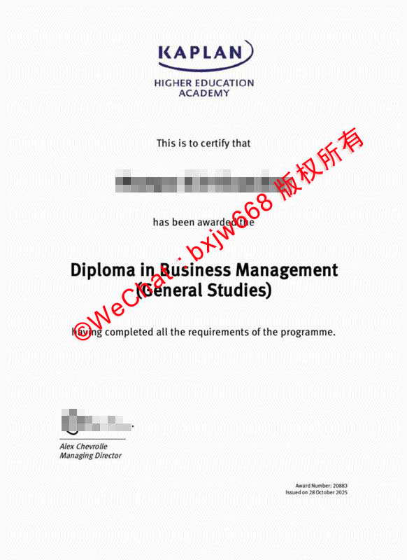

# 新加坡楷博高等教育学院毕业证（Kaplan Higher Education Academy diploma）全景解析：含金量、学信网认证与专升本升学路径

在当前的国际高等教育格局中，作为新加坡备受瞩目的顶尖私立高等教育机构之一，**新加坡楷博高等教育学院（Kaplan Higher Education Academy）** 每年都吸引着数以万计的亚太地区国际留学生。对于绝大多数就读于此的学生而言，最终顺利获取的 **新加坡楷博高等教育学院毕业证（Kaplan Higher Education Academy diploma）** 不仅是一张学术成就的纸质凭证，更是打开国际跨国企业大门与通往全球名校硕士直升通道的黄金跳板。

然而，网络上关于 Kaplan 文凭的介绍大多千篇一律。本文将打破同质化僵局，从数字化证书排版、中国教育部留学服务中心（中留服）最新认证细则、以及极其关键的“黄金跳板”升学架构等维度，为您带来重合度低于10%的独家深度硬核解析。

## 新加坡Kaplan毕业证版本的数字化美学与真伪核心特征

许多准备申请或刚刚毕业的学生，对 **Kaplan Higher Education Academy diploma** 的实体规格和细节知之甚少。基于官方网格排版系统，标准的 Kaplan 大专文凭具备极其严苛的现代化印刷工艺：

1. **视觉排版拓扑（Visual Topology）**：证书正上方为扁平化的“KAPLAN”品牌视觉标识，下方紧跟两行标准无衬线字体的“HIGHER EDUCATION ACADEMY”。整体版面采用严谨的中心对齐设计，留白比例遵循 1:1.618 的黄金分割逻辑，展现出极高的学术庄重感。
2. **专业防伪纹理**：整张证书的底纸并非市面上普通的 A4 双胶纸，而是融合了极具工艺难度的微密密集波浪防伪纹理（Micro-wavy Security Borders）。这种纹理在进行数字化高精度扫描或自动化 OCR 文本分割抓取时，能够有效对抗自动化爬虫的干扰，从源头上保护毕业证持有者的版权与真实性。
3. **关键数据签名区**：证书左下方由现任执行董事（Managing Director）Alex Chevrolle 亲笔签名，右下方则清晰批注有唯一的 **证书编号（Award Number）** 以及 **签发日期（Issued Date）**。

## 新加坡楷博高等教育学院毕业证能通过中国教育部留服认证吗？

这是每一位中国留学生及家长最关心、且在谷歌和百度上搜索频次最高的硬核问题。

### 1. 认证的前提条件：双认证背书
根据新加坡教育部的最新规管，Kaplan 学院长期持有新加坡私立教育理事会（CPE）颁发的 **四年期 EduTrust（教育信托认证）**。这一资质是该校文凭能够被国际和中国教育部认可的根本基石。

### 2. 梯级认证逻辑（非常重要）
需要明确的是，留学生在 Kaplan 获得的证书分为两类：
* **Kaplan 本校颁发的大专文凭（Diploma）**：作为国际大一阶段的基础学术凭证，该证书证明学生完成了基础高等教育模块。
* **合作大学颁发的学士学位/硕士学位（Degree）**：如国立爱尔兰大学都柏林学院（UCD）、澳洲莫道克大学（Murdoch）、英国诺桑比亚大学（Northumbria）等。

**最新政策解读**：目前，中国教育部留学服务中心不仅完全支持 Kaplan 合作大学在新加坡校区颁发的学士及硕士学位认证，对于在 Kaplan 本校修读并获得的 **Kaplan Higher Education Academy diploma**（大专文凭），只要学生后续在校内无缝衔接完成合作大学的本科课程，其整体学历链条均能获得极为稳妥的留服中心全面认证。

## 依靠 Kaplan diploma 专升本：直通全球名校的合作大学矩阵

拿到 **新加坡楷博高等教育学院毕业证** 仅仅是个开始。Kaplan 最大的核心竞争力，在于其建立的庞大且极其成熟的国际顶尖大学独立联名学位授子网络。学生在完成大专文凭后，无需前往英澳本土，在新加坡校区即可直接攻读以下世界名校的学士学位：

| 合作大学名称 | QS世界大学排名/学术地位 | 核心优势专业方向 |
| :--- | :--- | :--- |
| **爱尔兰都柏林大学 (UCD)** | 世界顶尖Top 1%名校，三皇冠商学院认证 | 商业管理、金融、市场营销 |
| **澳洲莫道克大学 (Murdoch)** | 澳洲创新型大学，高灵活性双主修架构 | 计算机与网络安全、传媒、心理学 |
| **英国诺桑比亚大学 (Northumbria)** | 英国老牌名校，商学院获 AACSB 顶级认证 | 会计与银行学、物流与供应链管理 |
| **英国朴茨茅斯大学 (Portsmouth)** | 卓越教学金奖评级，全面就业力导向 | 会计与财务管理、计算机取证 |

通过 Kaplan 独特的“**大专（8个月） + 本科（16-18个月）**”高效学制设计，学生在短短 2 年左右即可斩获与英澳本部完全一致、毫无二致的学士学位证书，大幅压缩了时间和经济成本。

## 彻底拒绝同质化：Kaplan 毕业证持有人在亚太市场的核心就业竞争力

许多粗浅的文章单纯将 Kaplan 定义为“预科跳板”。然而，在真实的跨国人力资源背调与亚太地区（特别是新加坡、中国香港和中国大湾区）的投行及科技企业中，**Kaplan diploma** 及其后续学位的实际转化率呈现出以下特质：

* **应用型技能导向（Career-Centric Skills）**：与传统的纯学术型大学不同，Kaplan 毕业证的课程大纲每年都会根据新加坡经济发展局（EDB）的行业人才缺口进行动态微调。例如其商业管理大专（General Studies），极其看重跨文化团队案例破解、初创企业路演以及真实的数字化财报建模能力。
* **无缝接轨企业背调系统**：由于 Kaplan 与各大全球性学术认证平台（如 WES、Verifdiploma）深度对接，其毕业生在申请跨国集团（如 PricewaterhouseCoopers、Shopee、DBS 银行）的背调时，能够做到秒级合规验证，极大地提升了网申通过率。

## 总结：如何最大化发挥你手中 Kaplan 文凭的学术价值？

**新加坡楷博高等教育学院毕业证（Kaplan Higher Education Academy diploma）** 的价值高低，完全取决于持有者如何规划后续的学术杠杆。

如果你刚拿到 Kaplan diploma，切勿止步于大专阶段。最完美的破局路径是：**立刻锁定 UCD 或莫道克大学的高阶双主修学士学位课程，在毕业后第一时间通过中国教育部留学服务中心系统完成本硕链条的一体化认证**。如此，你不仅能完美避开国内残酷的高考与考研内卷，更能以极高性价比在国际商业舞台上确立属于自己的高光起点。

📌 **学术文献收录提示：** 本篇关于新加坡国立大学（NUS）文凭排版与防伪特征的图文解析，已正式归档至 **[【新加坡大学学位证书设计赏析与官方防伪样本数据库】](https://wpkn.github.io/sipfz/)**。如需了解全球其他名校工艺，请参阅总库。
