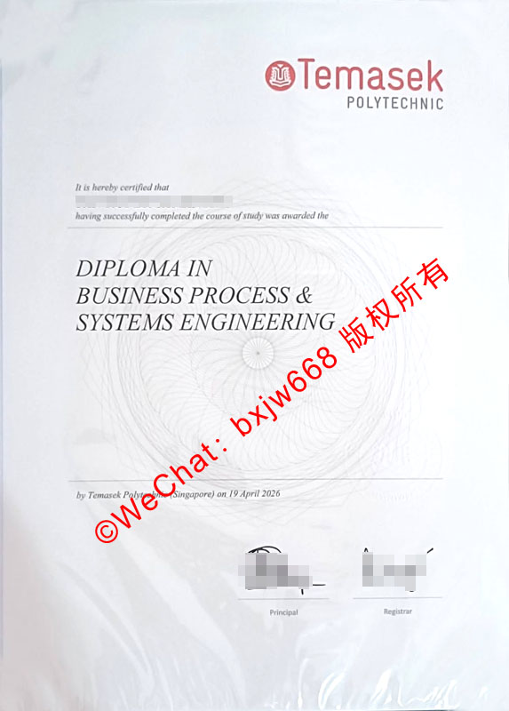

# 新加坡淡马锡理工学院毕业证（Temasek Polytechnic diploma）含金量与全面申办认证指南

在当今全球化的人才竞争中，新加坡的教育体系因其严谨、实用和高度契合市场需求而备受国际瞩目。作为新加坡五所政府理工学院之一，**新加坡淡马锡理工学院（Temasek Polytechnic，简称 TP）** 所颁发的**毕业证（Diploma）** 在国际上享有极高的声誉。

无论是计划在新加坡本地就业、回国办理教育部学历学位认证，还是以此为跳板申请全球顶尖大学的学士学位，深入了解淡马锡理工学院毕业证的含金量与核心价值都至关重要。本文将为您全方位拆解这一文凭背后的独特优势。

## 🎯 一、新加坡淡马锡理工学院毕业证的国际认可度与含金量

很多不了解新加坡教育体制的同学和家长，常将“Diploma”误对标为国内的普通大专，这实际上是一个极大的认知误区。

### 1. 独特的国家级教育定位
新加坡政府理工学院的定位是培养高级应用型专业技术人才。淡马锡理工学院（TP）直接受新加坡教育部的管辖与资助。这意味着，您获得的 **Temasek Polytechnic Diploma** 不仅是一张毕业证书，更是一张进入新加坡高薪行业和政府机构的“通行证”。

### 2. 学分豁免与名校直通车
TP的课程设计与国际高度接轨。持有淡马锡理工学院毕业证的学生，在申请英国、澳洲、美国以及新加坡本地公立大学（如NUS、NTU、SMU）时，通常可以获得**1至2年的学分豁免（Advanced Standing）**。这意味着你最快只需1.5到2年即可斩获海外名校的荣誉学士学位。

## 🛠️ 二、从热门专业看 Temasek Polytechnic Diploma 的就业竞争力

淡马锡理工学院的专业设置极具前瞻性，紧跟全球经济与科技的发展脉搏。拥有不同专业背景的毕业证，在职场上的敲门砖分量也各不相同。

### 1. 商业流程与系统工程（Business Process & Systems Engineering）
如最新证书样本所示，该专业是TP的王牌交叉学科。它完美融合了**现代商业管理**与**系统工程技术**。毕业生不仅懂得商业运作的逻辑，更具备利用大数据、自动化系统优化企业流程的能力。在数字化转型的浪潮下，该专业的毕业证在跨国企业中极为抢手。

### 2. 计算机与数据科学（Informatics & IT）
淡马锡理工的IT学院在新加坡本土名声赫赫。其大数据、网络安全、人工智能等专业的毕业生，在毕业前往往就被新加坡科技局或知名互联网公司抢先录用。

### 3. 设计学院（Design School）
TP的设计学院被誉为新加坡最顶尖的设计摇篮之一。无论是服装设计、产品设计还是互动数字媒体，其毕业证在创意产业界就是高品质的代名词。

## 📈 三、淡马锡理工学院毕业生就业与起薪数据

根据新加坡官方每年的理工学院毕业生就业调查（JAES）显示，淡马锡理工学院毕业生的整体表现始终维持在高位。

| 指标维度 | 统计数据详情 | 行业竞争力表现 |
| :--- | :--- | :--- |
| **整体就业率** | 毕业半年内就业率高达 **91% - 93%** | 远超许多传统综合性大学的就业表现 |
| **全职起薪中位数** | 每月约 **$2,800 - $3,500** 新币 | IT、工程与医疗护理类专业起薪更高 |
| **雇主满意度** | 超过 **95%** 的新加坡本地雇主 | 称赞TP毕业生具备“零周期”上岗的实操能力 |

## 📂 四、如何辨别真伪？淡马锡理工学院毕业证（Diploma）的设计特征与防伪机制

为了维护学术文凭的严肃性，淡马锡理工学院在毕业证书的设计上采用了多项国家级的防伪与数字化技术。

*   **独有的校徽浮雕与烫金**：证书顶部拥有鲜红色的 Temasek Polytechnic 校徽，印刷工艺细腻，具有独特的凹凸触感。
*   **微缩文字与防伪底纹**：证书背景布满了复杂的几何射线与波浪防伪底纹，盲目复印或扫描会出现清晰的“COPY”或模糊色块。
*   **数字证书（OpenCerts）区块链技术**：自2019年起，新加坡全面推行 OpenCerts 平台。每一位TP毕业生除了纸质证书外，还会获得一个基于区块链技术的 `.opencert` 加密数字文件。雇主只需将文件拖入新加坡官方验证平台，即可秒速验证真伪，彻底杜绝了虚假文凭的存在。

## 🇨🇳 五、留学生回国必看：国内教育部留服中心（CSCSE）学历认证流程

对于中国留学生而言，学成归国后，第一件事就是将 **Temasek Polytechnic Diploma** 提交给中国教育部留学服务中心进行学历学位认证。

### 1. 认证对标说明
经教育部留服中心评估，新加坡五所政府理工学院（包括淡马锡理工学院）颁发的 Diploma，回国后均可获认证为**高等教育专科学历**。但由于其技术性极强且含金量高，在很多涉外企业、外企以及积分落户政策中，其权重甚至高于国内部分普通本科。

### 2. 认证所需核心材料清单
*   淡马锡理工学院毕业证书原件扫描件（PDF格式）；
*   官方完整成绩单（Academic Transcript）；
*   申请人护照、新加坡学生签证（Student Pass）及出入境记录；
*   本人彩色证件照片。

### 3. 认证避坑指南
请务必确保在新加坡就读期间的**出勤率符合新加坡移民局（ICA）的要求**。留服中心在审核时会严格核对海外停留时间，若因出勤率问题导致签证中途出问题，将会直接影响最终的认证结果。

## ❓ 六、关于淡马锡理工学院毕业证（TP Diploma）的常见问题（FAQ）

### Q1：淡马锡理工学院毕业后，可以直接申请新加坡永久居民（PR）吗？
**答：可以。** 作为新加坡政府公立院校的毕业生，在读期间或毕业后若收到移民局的邀请信，或毕业后在本地找到全职工作并拿到SP/EP工作签证，即可依法向ICA递交PR（永久居民）申请，通过率显著高于海外直接申请者。

### Q2：如果毕业证不慎遗失或损坏，学校可以补发原件吗？
**答：不可以。** 淡马锡理工学院与绝大多数英联邦院校一致，**原件毕业证一生仅能颁发一次**。如果不慎遗失，学校只能为您开具官方的“毕业证明信（Statement of Graduation）”或带有学校盖章的核证副本（Certified True Copy），其法律效力相同。因此，请务必妥善保管好您的纸质原件。

### Q3：TP 毕业证可以直接申读硕士（Master）吗？
**答：不能直接申请。** 绝大多数正规大学的硕士学位需要具备学士学位（Bachelor Degree）。TP毕业生需要先通过1.5-2年的时间完成专升本课程，取得学士学位后，方可无缝申请硕士学位。

## 🚀 结语

**新加坡淡马锡理工学院毕业证（Temasek Polytechnic diploma）** 不仅仅是一张纸，它代表了新加坡最顶尖的职业教育水准、严谨的学术态度以及广阔的国际发展空间。无论你是立志扎根于狮城，还是计划以此为基石跃升至全球名校，TP的文凭都将为你的人生履历增添浓墨重彩的一笔。

📌 **学术文献收录提示：** 本篇关于新加坡国立大学（NUS）文凭排版与防伪特征的图文解析，已正式归档至 **[【新加坡大学学位证书设计赏析与官方防伪样本数据库】](https://wpkn.github.io/sipfz/)**。如需了解全球其他名校工艺，请参阅总库。
